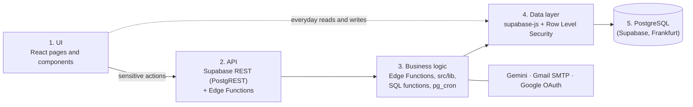

# Miora (ميورا)

[](https://github.com/eslambhaa/MIORA-SITE/actions/workflows/test.yml)


**Miora** is an Arabic, right-to-left web platform for mental wellbeing education. It helps people understand their feelings, try short relaxation exercises, keep a private journal and learn from carefully written content, at their own pace and without judgment.

**Live site:** https://www.miora.workers.dev

> Miora is an educational tool. It does not diagnose, does not provide treatment, and is not a substitute for a qualified professional. If you are in danger right now in Egypt, call the ambulance on **123** or the mental health hotline on **16328**.

This is a graduation project from Zagazig University.

---

## Features

- **Daily mood check-in** with a streak and a personal journey view.
- **Private journal**: entries are visible only to their author, and can be exported or deleted.
- **Self-assessments** (mood, stress, sleep, habits): reflective questions with guidance, not diagnosis.
- **Relaxation exercises**: breathing, grounding, mindfulness and body scan, with reduced-motion support.
- **Awareness library**: articles, videos and podcasts with Arabic-aware search and topic filters.
- **Addiction awareness section**: stigma-free information and a clear help path (hotline 16023).
- **AI assistant** powered by Google Gemini, with consent, rate limits, and a fixed crisis reply when risk words appear.
- **In-site notifications** with scheduled reminders.
- **Admin dashboard**: manage articles and episodes, check broken media links, read contact messages, edit emergency numbers, see aggregate statistics only, send announcements and export a content backup.
- **Accounts**: email and password (with confirmation and password reset) or Google sign-in, and full account deletion.

## Tech stack

| Layer | Technology |
|---|---|
| Frontend | React 19, Vite 8, React Router 8, Tailwind CSS v4 (JavaScript) |
| Backend | Supabase: PostgreSQL with Row Level Security, Auth, Storage, Edge Functions (Deno), `pg_cron` |
| AI | Google Gemini, called only from a server-side Edge Function |
| Email | Gmail SMTP through Supabase Auth, with Arabic templates |
| Hosting | Cloudflare Workers (static assets, single-page app routing) with automatic deploys from `main` |
| Tests | Vitest and Testing Library |

## Architecture

Miora follows a layered, serverless (Backend-as-a-Service) design:



- **Everyday reads and writes** (an article, a journal entry) go from the browser through `supabase-js` straight to the database. Row Level Security makes sure each row is reachable only by its owner (`auth.uid()`), whatever the browser sends.
- **Sensitive actions** run in Edge Functions that keep their secrets on the server: `assistant` (Gemini), `delete-account`, and `admin-media-tools` (admins only).
- **Admin rights** are checked in the database (`admin_users` table), not by hiding buttons in the interface.

## Project structure

```
miora-app/
├── src/
│   ├── pages/           # One file per route (Home, Content, Journal, Admin…)
│   ├── components/      # Shared UI (header, footer, cards, players…)
│   ├── auth/            # Auth provider and route guards
│   ├── lib/             # Data access and business helpers (+ *.test.js)
│   ├── data/            # Built-in fallback content (articles, illustrations)
│   └── test/            # Cross-cutting tests (templates, share tags, crawl files…)
├── supabase/
│   ├── migrations/      # Database schema, RLS policies and seed data
│   ├── functions/       # Edge Functions: assistant, delete-account, admin-media-tools
│   └── templates/       # Arabic email templates (confirm signup, reset password)
├── public/              # Images, icons, _headers (security headers), robots.txt, sitemap.xml
├── scripts/             # Helper scripts (share image renderer, podcast feed reader)
├── vite.config.js       # Build config, including the Content Security Policy
└── wrangler.jsonc       # Cloudflare Workers config
```

## Getting started

**Requirements:** Node.js 22 or newer, and a Supabase project.

```bash
git clone https://github.com/eslambhaa/MIORA-SITE.git
cd MIORA-SITE
npm install
cp .env.example .env
npm run dev
```

Open http://localhost:5173.

### Environment variables

The frontend only needs two **public** values (`.env`, never commit it):

| Variable | Where to find it |
|---|---|
| `VITE_SUPABASE_URL` | Supabase → Project Settings → API |
| `VITE_SUPABASE_PUBLISHABLE_KEY` | Supabase → Project Settings → API keys (the *publishable* key, never the secret one) |

Server secrets live only in Supabase (Edge Functions → Secrets):

| Secret | Purpose |
|---|---|
| `GEMINI_API_KEY` | Required by the `assistant` function |
| `GEMINI_MODEL` | Optional first model to try |
| `ALLOWED_ORIGIN` | Comma-separated origins allowed to call the functions, e.g. `https://www.miora.workers.dev,http://localhost:5173` |

### Database and functions

1. Apply the SQL files in `supabase/migrations/` in order (Supabase CLI or SQL Editor).
2. Deploy the three Edge Functions in `supabase/functions/` with **Verify JWT** on.
3. In Supabase Auth, set the Site URL and Redirect URLs, enable Google if needed, and paste the templates from `supabase/templates/`.
4. Make yourself the first admin with the commented `insert` at the top of `20261029000000_admin_foundation.sql` (replace `<owner email>`). Later admins can be added from the dashboard.

## Scripts

| Command | What it does |
|---|---|
| `npm run dev` | Start the development server |
| `npm test` | Run the test suite (Vitest) |
| `npm run build` | Build the production site into `dist/` |
| `npm run preview` | Preview the production build locally |
| `npm run deploy` | Build and deploy to Cloudflare with Wrangler |

## Testing

```bash
npm test
```

Tests sit next to the code as `*.test.js(x)` inside `src/`. They cover data helpers, admin rules, CORS handling, email templates, share tags, and more. Every bug fix comes with a regression test.

## Deployment

The site is hosted on **Cloudflare Workers** as static assets with single-page-app routing (`wrangler.jsonc`). Cloudflare builds and deploys automatically on every merge to `main` (build command `npm run build`, deploy command `npx wrangler deploy`), with the two `VITE_` variables set as build variables.

## Security and privacy

- **No secrets in the frontend.** Only the Supabase URL and publishable key reach the browser.
- **Row Level Security on every table**, with each policy tied to `auth.uid()`.
- **The admin dashboard never shows personal content**: no journals, assistant chats, assessment results or individual moods. Statistics are aggregated only.
- **Security headers** (`public/_headers`): HSTS, `nosniff`, `frame-ancestors 'none'`, a strict referrer policy and a permissions policy. A Content Security Policy is added at build time.

## Accessibility

Built for Arabic, right-to-left reading: WCAG AA contrast, visible focus outlines, a label for every field, one `h1` per page, and respect for reduced motion.

## Content notice

Articles, assessment questions and exercise scripts are educational drafts and should be reviewed by a qualified specialist. The privacy policy and terms need legal review before wide public use.

## License

No license has been chosen yet, so all rights are reserved by the author. Please open an issue if you would like to reuse any part of the project.
